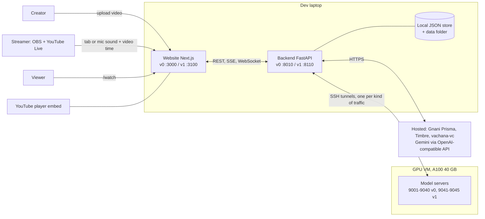
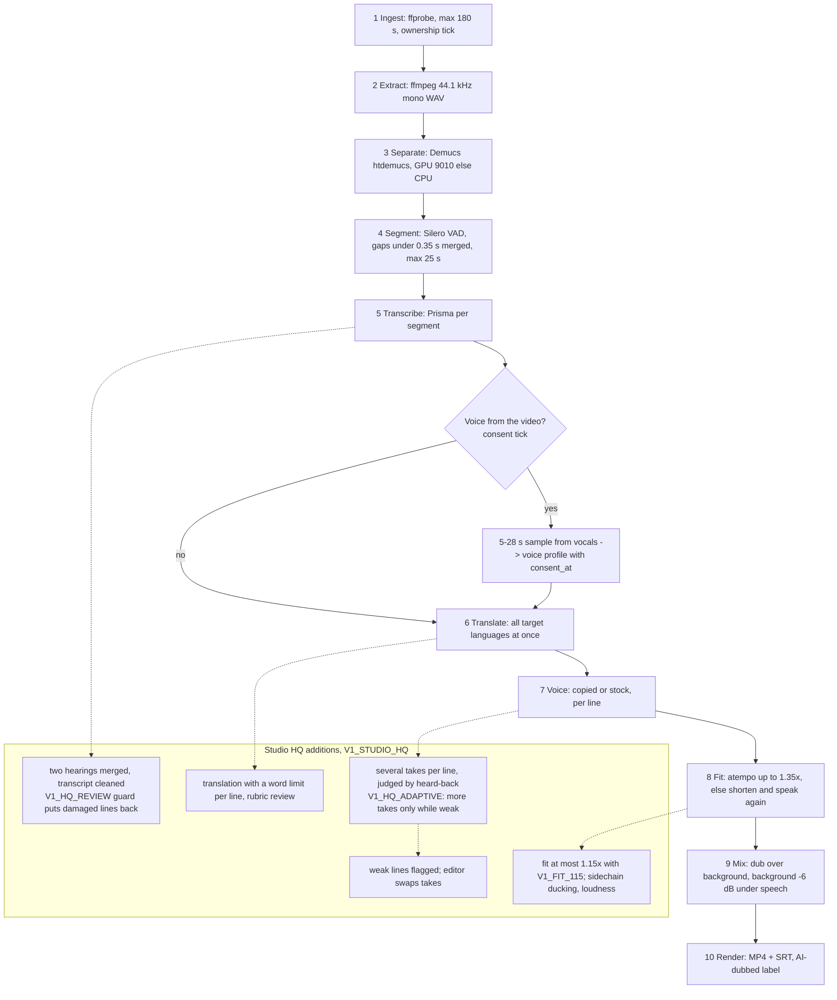
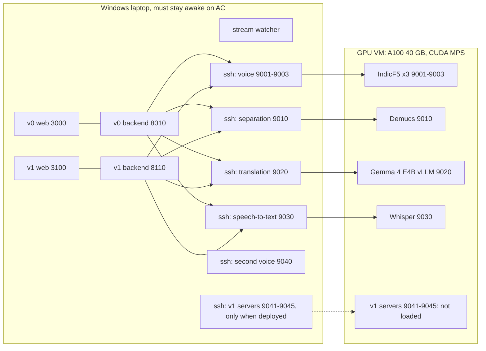

# Architecture

How Bharat Dub is put together, v0 and v1 side by side. Dated 2026-11-25.
Sources: `SPEC.md` sections 5-9 and 21, `docs/v1/DISCOVERY.md`, `docs/v1/ARCHITECTURE.md`, `docs/v1/RUNBOOK.md`,
`backend/config/routing.yaml`, `gpu_engine_v1/README.md`, v0's `gpu_engine/README.md` (read-only).
Terms: [GLOSSARY.md](GLOSSARY.md). Models: [MODELS.md](MODELS.md).

## System context

One FastAPI backend and one Next.js website (a modular monolith), model servers on one GPU machine, hosted
services for what our GPU does not do (or does worse).



Decided in [ADR-0002](adr/0002-modular-monolith.md), [ADR-0013](adr/0013-best-provider-per-capability.md),
[ADR-0019](adr/0019-v1-on-laptop.md).

## Components and ports

| Component | v0 | v1 | Where | Code |
|---|---|---|---|---|
| Website | 3000 | 3100 | laptop | `web/` |
| Backend | 8010 | 8110 | laptop (v1 on the VM is NEEDS_APPROVAL item 2) | `backend/app/` |
| IndicF5 voice engines x3 | 9001-9003 | shared (call only) | VM, 127.0.0.1 | v0 `gpu_engine/voice_engine_live.py` |
| Demucs separation | 9010 | shared | VM | v0 `gpu_engine/sep_engine.py` |
| Gemma 4 E4B on vLLM (served as `local`) | 9020 | shared | VM | v0 `gpu_engine/start_llm.sh` |
| Whisper-Hindi2Hinglish-Apex | 9030 | shared | VM | v0 `gpu_engine/stt_engine.py` |
| Indic-Mio (stopped) | 9040 (+ its model on 9021) | - | VM | v0 `gpu_engine/mio_engine.py` |
| Batching voice server | - | 9041 (not loaded) | VM | `gpu_engine_v1/tts_server.py` |
| Maya 2 | - | 9042 (not loaded) | VM | `gpu_engine_v1/maya_server.py` |
| Indic Transcribe | - | 9043 (not loaded) | VM | `gpu_engine_v1/transcribe_server.py` |
| Big translation model (12B/31B) | - | 9044 (not loaded) | VM | vLLM, deploy kit |
| QA server (hear back, speaker similarity, diarization, `/gpu`) | - | 9045 (CPU, not deployed) | VM | `gpu_engine_v1/qa_server.py` |
| Comparison backends (measurement only) | - | 8111-8115, 8116-8118, 8120+ | laptop | `scripts/v1/ab-server.ps1` |

v1 never binds 3000, 8010 or 9001-9040; it only calls the shared GPU servers. Five comparison backends from the
25 Nov Studio measurement were left running on 8111-8115 (NEEDS_APPROVAL item 18).

Decided in [ADR-0018](adr/0018-v1-beside-v0.md), [ADR-0033](adr/0033-deploy-kit-4gb-rule.md).

## Provider layer

Every speech-to-text, translation and voice call goes through `backend/app/providers/` behind the interfaces of
SPEC section 7 (`STT`, `StreamingSTT`, `LLM`, `TTS`). Pipelines never call HTTP APIs directly. Each provider has
a timeout, one retry where safe, and a fallback.

`providers/__init__.py` resolves the engine per session or job (`engine_of()`: `cloud` or `gpu`) and builds:

| Step | `cloud` (Standard) | `gpu` |
|---|---|---|
| Speech-to-text | Prisma | Prisma first, Whisper 9030 behind it (`GPU_STT_FIRST=hosted`; `gpu` reverses) |
| Translation | Gemini | Gemma 9020 first, Gemini behind it |
| Copied voice, Indian languages | IndicF5 9001-9003 when `GPU_VOICE_URL` is set, else hosted clone | IndicF5 with the short-line guard |
| Stock voice and English | Timbre | Timbre |
| Separation (Studio) | Demucs 9010 when `GPU_SEPARATE_URL` is set, else CPU | same |

Source: `docs/v1/DISCOVERY.md` section 2. The hosted account allows one request at a time (SPEC section 16,
measured 13 Nov 2026): all Gnani calls pass one process-wide gate.

### v1 router

With `V1_ROUTER=true`, `backend/app/v1/router.py` reads `backend/config/routing.yaml`: per mode (`live`, `studio`,
`studio_hq`), per engine and per step, a list of providers in order. The first one that is configured and answers
is used; a provider with no address or key is skipped. The shipped file reproduces v0 exactly. Timeouts per step:
transcribe 30 s, translate 20 s, speak 20 s, separate 180 s, diarize 180 s, score 40 s. `GET /api/v1/routing` shows
what is configured and in use.

`studio_hq` lists, for both engines: transcribe `[prisma, indic_transcribe, whisper_gpu]` (all that answer are
heard and merged), translate `[big_llm, gemma, gemini]`, review `[big_llm, gemini, gemma]`, candidates `[maya]`,
diarize `[qa_server, none]`, score `[qa_server, prisma]`.

### Breakers and the degrade ladder (v1.1 WS0)

With `V1_BREAKER`: one breaker per GPU endpoint. A timeout, or 2 failures in 10 s, opens it for 30 s; calls then
fail at once and the fallback answers. A live translation call gets 3 s, a voice line 4 s on our GPU. While a
session is live every GPU endpoint's health is asked every 5 s; all failing in one round is a link stall and opens
every circuit. With `V1_LIVE_DEGRADE`: the ladder copied voice -> stock voice -> captions only -> original sound,
two failures step down, one success steps up (`docs/v1/PROGRESS.md`, v1.1 WS0).

Decided in [ADR-0002](adr/0002-modular-monolith.md), [ADR-0014](adr/0014-two-engines-per-session.md),
[ADR-0015](adr/0015-gpu-stt-translation.md), [ADR-0016](adr/0016-hosted-stt-first.md),
[ADR-0021](adr/0021-config-provider-router.md), [ADR-0027](adr/0027-breakers-degrade-ladder.md).

## Live data flow

```mermaid
sequenceDiagram
  participant C as Console (/live or /streamer)
  participant B as Backend (pipeline)
  participant S as Speech-to-text
  participant P as Phraser
  participant T as Translator
  participant V as Voice
  participant Bus as Bus (per session, per language)
  participant W as Viewer (/watch)
  C->>B: PCM16 16 kHz frames + {"type":"media","t"} (WS /ws/ingest)
  B->>S: 1024-byte frames, real-time cadence
  S-->>B: partial_transcript (stable_text) about every 0.3-0.5 s
  B->>P: stable text
  P-->>B: phrase (6-12 words at a clause boundary) or final tail
  par every target language at once
    B->>T: translate_chunk (context, glossary, word budget)
    T-->>B: translated line
    B->>Bus: caption (seq, t_speech_ms, media_s)
  end
  B->>V: one language worker per language, in order, only for languages with viewers
  V-->>B: audio (fit: trim, tempo up to 1.3x, skip if more than 8 s late)
  B->>Bus: audio frames (seq, media_s)
  Bus-->>W: caption, audio, sync {media_s, delay_ms}, stats (WS /ws/watch)
  W->>W: video held by the hold; each phrase starts at its media moment
  W-->>B: played {late_ms}
```

- Voice learned from the stream (with consent): about 7 s cut before the first pause, ready about 9 s in; stock
  voices until then (SPEC section 16).
- Streamer Mode: the recorded voice is sent to the engines at session start; a mic session uses `offset_ms`
  (0-40 s) instead of the video clock.
- v1.1 additions, each behind a flag: duration budget and rate control (WS1), warm start and English single voice
  (WS2), breaker and ladder (WS0), opt-in recording (WS4).

Decided in [ADR-0006](adr/0006-prisma-realtime-partials.md), [ADR-0007](adr/0007-hosted-llm-translation.md),
[ADR-0008](adr/0008-heard-delay-pacing.md), [ADR-0009](adr/0009-sync-mode-hold.md),
[ADR-0012](adr/0012-streamer-mode-recorded-voice.md), [ADR-0017](adr/0017-one-voice-short-lines.md),
[ADR-0028](adr/0028-dub-duration-budget.md), [ADR-0031](adr/0031-english-single-voice.md),
[ADR-0032](adr/0032-opt-in-live-recording.md).

## Studio data flow



Every stage is cached by content hash under `<data>/cache/<stage>/`; editing one line re-runs stages 7-10 for that
line. Progress is server-sent events (`GET /api/jobs/{id}/events`). HQ jobs can be held and run in phases inside
an HQ window (`POST /api/v1/hq/batch`, `docs/v1/RUNBOOK.md` section 5).

Decided in [ADR-0001](adr/0001-cascaded-pipeline.md), [ADR-0003](adr/0003-studio-stage-cache.md),
[ADR-0005](adr/0005-consent-gates-cloning.md), [ADR-0024](adr/0024-studio-hq-takes.md),
[ADR-0030](adr/0030-hq-judge-and-review.md).

## Deployment



- v0's `gpu_engine/tunnel.ps1` opens one SSH connection per kind of traffic (voice, voice-mio, separation,
  translation, speech-to-text), since `9fae6c8` (21 Nov 2026): one stalled packet had held every engine up
  together on a real stream ([INC-04](INCIDENTS.md#inc-04-tunnel-stalls-on-the-67-min-stream)).
- The engines listen on the VM's 127.0.0.1 only. The VM's address is in `docs/v1/NEEDS_APPROVAL.md`, never here.
- The engines do not start by themselves after a VM restart: v0's `start_live.sh`, `start_sep.sh`, `start_llm.sh`,
  `start_stt.sh` (`docs/v1/RUNBOOK.md` section 1).
- Measured cost of the tunnel: first audio p50 2.3 s through it against 1.8 s with the backend on the VM (SPEC
  section 21, 21 Nov 2026, one run each, **measured**).

### GPU memory on the A100 (40 GB)

| Server | Memory | Label | Source |
|---|---|---|---|
| IndicF5 x3 (9001-9003) | about 12 GB | estimate | v0 `gpu_engine/README.md`; `docs/v1/ARCHITECTURE.md` |
| each IndicF5 process, torch allocation | 1.43 GB (process total higher) | measured (reported by the engine) | `docs/v1/DISCOVERY.md` section 6, 23 Nov 2026 |
| Demucs (9010) | about 1.4 GB (0.18 GB allocated) | estimate (allocation measured) | `docs/v1/ARCHITECTURE.md`; DISCOVERY section 6 |
| Gemma 4 E4B (9020) | about 18-19 GB (memory share 0.45-0.5 of the card) | estimate | `docs/v1/ARCHITECTURE.md` (18), v0 README (19, share 0.5), DISCOVERY (share 0.45) |
| Whisper (9030) | about 2-2.5 GB | estimate | v0 README (2), `docs/v1/ARCHITECTURE.md` (2.5) |
| All v0 engines together | 34.7 of 40 GB | measured | SPEC section 21, 21 Nov 2026 |
| With Indic-Mio loaded as well | about 39 of 40 GB | measured | SPEC section 21, 21 Nov 2026 night |
| Free beside v0 | about 6 GB | estimate | `docs/v1/MODELS.md` |

`docs/v1/DISCOVERY.md` reads the 34.7 GB as "with Indic-Mio loaded" (33.7 GB without); SPEC section 21 gives 34.7
GB before Indic-Mio and about 39 GB with it. The per-process `nvidia-smi` table is NEEDS_APPROVAL item 1.

Rule: a new model loads only if free memory minus its need stays at least 4 GB. An **HQ window** stops Gemma on
9020 (about 24 GB free, **estimate**) to load big models; v0 and v1 then translate through Gemini by themselves.

Decided in [ADR-0010](adr/0010-indicf5-own-gpu-voice.md), [ADR-0011](adr/0011-borrowed-a100-ssh-tunnels.md),
[ADR-0019](adr/0019-v1-on-laptop.md), [ADR-0033](adr/0033-deploy-kit-4gb-rule.md).

## Data and storage

- `LocalStore`: one JSON file (`<DATA_DIR>/local_db.json`) held in memory by one backend process and written on
  every change. Two processes on one file overwrite each other ([INC-03](INCIDENTS.md#inc-03-stale-voice-profile-text-written-back-by-server)).
- v0 data: `backend/data` in the v0 folder. v1 data: `data-v1/` in the v1 folder (git-ignored). v1 never reads v0's store.
- Supabase was never configured on the running setup; `V1_STORE=postgres` is written and never run.

Decided in [ADR-0004](adr/0004-local-json-store.md), [ADR-0018](adr/0018-v1-beside-v0.md).

## Flags

All in v1's `backend/.env`, all off by default; tests force them off; restart the backend after a change. The full
list (26 in `backend/app/v1/flags.py` plus `V1_STORE`) with what each does: `../v1/RUNBOOK.md` section 3. The
recommended set: [RUNBOOK.md](RUNBOOK.md#flags-and-the-recommended-v1-env).

| Group | Flags |
|---|---|
| Observability and routing | `V1_TRACE`, `V1_ROUTER`, `V1_API_LOG` |
| Live | `V1_PHRASE_DYNAMIC`, `V1_LIVE_LATE_SHORTEN`, `V1_LIVE_BACKCHECK`, `V1_LIVE_STOCK_DEFAULT`, `V1_BREAKER`, `V1_LIVE_DEGRADE`, `V1_LIVE_BUDGET`, `V1_LIVE_RATECTRL`, `V1_LIVE_NATIVE_SPEED`, `V1_LIVE_WARMSTART`, `V1_EN_SINGLE_VOICE`, `V1_LIVE_RECORD` |
| Studio | `V1_STUDIO_HQ`, `V1_FIT_115`, `V1_HQ_JUDGE`, `V1_HQ_CALIBRATE`, `V1_HQ_ADAPTIVE`, `V1_HQ_NORMALISE`, `V1_HQ_AUTO_GLOSSARY`, `V1_HQ_REVIEW`, `V1_TTS_MAYA` |
| Model servers | `V1_TTS_SERVER` |
| Pages | `V1_LISTEN_TEST` (and `V1_HQ_CALIBRATE`) |
| Store | `V1_STORE` (`json` or `postgres`) |

`V1_SPEC_TRANSLATE` and `V1_LLM_PREFIX_CACHE` were removed in v1.1 WS6 (`e3128ef`); a leftover line is ignored.

Decided in [ADR-0020](adr/0020-flags-default-off.md), [ADR-0029](adr/0029-drop-spec-translate-prefix-cache.md).

## Trace and logs

- `V1_TRACE`: one JSONL record per Live phrase and Studio line (which provider did each step, whether a fallback
  answered), plus Prometheus `/metrics`; `/metrics-ui` reads it.
- `V1_API_LOG`: one line per outbound provider request under `logs/api/<date>/` (call, host, path, status, ms,
  attempt, bytes; no bodies, no keys).
- `logs/` in the repository holds measurements only: `sessions/index.csv` (one row per Live session and language),
  `jobs/index.csv`, `trace/`, `streams/` (the stream watcher). Written by `scripts/v1/collect-logs.py`. No source
  text, translation, audio or ids of voices (`logs/README.md`).
- The stream watcher (`scripts/v1/stream-watch.ps1`) watches every live session on v0 and v1, read-only, and writes
  `data-v1/streamwatch/events.log` (`ENGINE DOWN/BACK`, `LINK STALL/BACK`, `CIRCUIT ...`, `RUNG ...`).

Decided in [ADR-0022](adr/0022-trace-and-logs.md).
