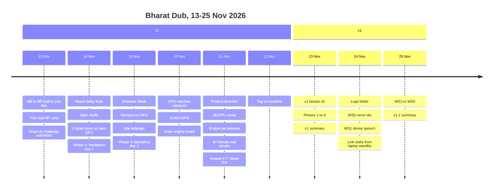

# Timeline, 13-25 Nov 2026

What happened when, from the first commit to the v1.1 summary. Curated by hand from git, `SPEC.md` sections 16-21,
`docs/v1/PROGRESS.md`, `docs/v1/SUMMARY.md` and `docs/v1/V1_1_SUMMARY.md`. The full commit list is generated in
[COMMITS.md](COMMITS.md). Dates are the commit dates (India time) unless the source says otherwise.

Bharat Dub started as an entry for two events: the Gnani AI challenge (submitted 13 Nov 2026) and the Vihaan X
hackathon (14-15 Nov 2026). Both are over and are listed here only as history. Since 21 Nov it is built as a
startup product ([ADR-0013](../adr/0013-best-provider-per-capability.md)).

## Events

Kind: milestone (a build step), release (a tag or summary that closes a version), decision (an ADR), result (a
measurement, see the experiment), incident (see [INCIDENTS.md](../INCIDENTS.md)).

| Date | Event | Kind | Links |
|---|---|---|---|
| 2026-11-13 | Scaffold, providers and smoke script (M0 + M1) | milestone | `227f031` |
| 2026-11-13 | Cascaded pipeline, one backend and one site, providers behind interfaces | decision | [ADR-0001](../adr/0001-cascaded-pipeline.md), [ADR-0002](../adr/0002-modular-monolith.md) |
| 2026-11-13 | Studio pipeline stages 1-10, job API, voices, glossary (M2); stage cache; local JSON store | milestone | `df1fa91`, [ADR-0003](../adr/0003-studio-stage-cache.md), [ADR-0004](../adr/0004-local-json-store.md) |
| 2026-11-13 | Consent gates voice copying (403 without it) | decision | [ADR-0005](../adr/0005-consent-gates-cloning.md) |
| 2026-11-13 | Live backend (M3) and the full site (M4/M5) | milestone | `e4728b7`, `5f1d896` |
| 2026-11-13 | First runs against the real hosted APIs; account allows 1 request at a time | result | `66de705`, [EXP-001](../experiments/EXP-001-gnani-smoke-latency.md) |
| 2026-11-13 | Demucs on the laptop CPU: 40.3 s for 60 s of audio (measured, `SPEC.md` section 16) | result | [EXP-002](../experiments/EXP-002-separation-cpu-vs-gpu.md) |
| 2026-11-13 | Translation on hosted Gemini through an OpenAI-compatible endpoint | decision | `ee932e8`, [ADR-0007](../adr/0007-hosted-llm-translation.md) |
| 2026-11-13 | Live end to end on real APIs, stock voices; phrases cut from realtime partials, source language pinned | result | `a7e7bb6`, `751375f`, `2188ad3`, [EXP-003](../experiments/EXP-003-live-stock-first-audio.md), [ADR-0006](../adr/0006-prisma-realtime-partials.md) |
| 2026-11-13 | Gnani AI challenge entry submitted (history; the event no longer shapes decisions) | milestone | `SPEC.md` section 1 |
| 2026-11-14 | Live judged by what the viewer hears: trim, tempo fit, merge waiting phrases | decision | `a88de86`, `0b6d9f8`, [ADR-0008](../adr/0008-heard-delay-pacing.md), [EXP-004](../experiments/EXP-004-heard-vs-first-audio.md) |
| 2026-11-14 | Live translation model bench | result | [EXP-005](../experiments/EXP-005-live-llm-bench.md) |
| 2026-11-14 | Sync mode: viewer holds the video and plays each phrase at its moment | decision | `ecd2298`, [ADR-0009](../adr/0009-sync-mode-hold.md), [EXP-006](../experiments/EXP-006-sync-mode.md) |
| 2026-11-14 | Copied voice from IndicF5 on our own GPU; pool of three engines | decision | `770112f`, `d911d2a`, [ADR-0010](../adr/0010-indicf5-own-gpu-voice.md), [EXP-007](../experiments/EXP-007-copied-voice-hosted-vs-gpu.md) |
| 2026-11-14 | GPU VM reached through SSH tunnels from the laptop | decision | `7fba6ab`, [ADR-0011](../adr/0011-borrowed-a100-ssh-tunnels.md) |
| 2026-11-14 to 15 | Vihaan X hackathon (history) | milestone | `SPEC.md` section 1 |
| 2026-11-15 | Streamer Mode: voice recorded once with spoken consent, scored and stored | decision | `c401e5a`..`8d82653`, [ADR-0012](../adr/0012-streamer-mode-recorded-voice.md), [EXP-008](../experiments/EXP-008-streamer-mode-first.md) |
| 2026-11-15 | Demucs on the GPU machine with CPU fallback | result | `60ee40b`, [EXP-002](../experiments/EXP-002-separation-cpu-vs-gpu.md) |
| 2026-11-15 | Site redesign: three-mode header, landing hero, streamer page | milestone | `bc6a3e0`..`29aef48` |
| 2026-11-15 | A wrong PC clock stopped every hosted connection | incident | `89b68e4`, INC-01 in [INCIDENTS.md](../INCIDENTS.md) |
| 2026-11-20 | GPU machine replaced; engines rebuilt; CUDA MPS lets three processes run at once | milestone | `0143cbd`, [ADR-0010](../adr/0010-indicf5-own-gpu-voice.md) |
| 2026-11-20 | Voice engine tuned (letters not bytes, sample length, denoising steps) | result | `59dbb97`, [EXP-009](../experiments/EXP-009-voice-engine-tuning.md) |
| 2026-11-21 | Voice engine about twice as fast (batched guidance, MP3 transport) | result | `ada2272`, [EXP-010](../experiments/EXP-010-voice-engine-speedup.md) |
| 2026-11-21 | Startup product: best measured provider per capability, no single-vendor rule | decision | `40f6183`, [ADR-0013](../adr/0013-best-provider-per-capability.md) |
| 2026-11-21 | Sync stamp fix; hold grows by at most 1 s a step | result | `a60b6d8`, `6667f1a`, `86188e5`, [EXP-011](../experiments/EXP-011-sync-stamps-and-hold.md) |
| 2026-11-21 | Hosted speech-to-text failed every request until 06:13 UTC | incident | INC-02 in [INCIDENTS.md](../INCIDENTS.md) |
| 2026-11-21 | Stored voice profile text written back stale by the running server | incident | `86188e5`, INC-03 in [INCIDENTS.md](../INCIDENTS.md), [EXP-012](../experiments/EXP-012-clone-similarity.md) |
| 2026-11-21 | Denoising steps per voice kind; pace target 450 ms a word | result | `b5807d0`, `e4bb35a`, [EXP-013](../experiments/EXP-013-steps-and-pace.md) |
| 2026-11-21 | All-GPU mode: speech-to-text and translation on our GPU, hosted as fallback | decision | `cc7fd39`, `bcee6aa`, `4709425`, [ADR-0015](../adr/0015-gpu-stt-translation.md), [EXP-014](../experiments/EXP-014-standard-vs-gpu-engine.md), [EXP-015](../experiments/EXP-015-gemma-vs-gemini-latency.md) |
| 2026-11-21 | Engine chosen per Live session and per Studio job | decision | `31673b9`, [ADR-0014](../adr/0014-two-engines-per-session.md) |
| 2026-11-21 | Real 67-minute stream in all-GPU mode; link stalls; one tunnel per kind of traffic | result | `fd93754`, `9fae6c8`, [EXP-016](../experiments/EXP-016-real-stream-67min.md), INC-04 in [INCIDENTS.md](../INCIDENTS.md), [ADR-0011](../adr/0011-borrowed-a100-ssh-tunnels.md) |
| 2026-11-21 | Indic-Mio tried as a second voice; short lines stay in IndicF5 | decision | `4f3d177`, `b151c39`, `94c8e90`, [EXP-017](../experiments/EXP-017-indic-mio-vs-indicf5.md), [ADR-0017](../adr/0017-one-voice-short-lines.md) |
| 2026-11-21 | Speech-to-text on hard audio: hold-back of the last word, beam 5 | result | `be7540b`, [EXP-018](../experiments/EXP-018-prisma-vs-whisper-hard-audio.md) |
| 2026-11-21 | In the GPU engine the hosted service hears first | decision | `3a20c06`, [ADR-0016](../adr/0016-hosted-stt-first.md), [EXP-019](../experiments/EXP-019-hosted-stock-vs-copied-voice.md) |
| 2026-11-22 | Tag `v0-baseline`: v0 frozen | release | `80c36d8` |
| 2026-11-22 to 23 | v1 built beside v0 (own checkout, branch, ports 3100/8110, data, env) | decision | [ADR-0018](../adr/0018-v1-beside-v0.md) |
| 2026-11-23 | v1 setup: rules, commit hooks, docs | milestone | `92638c1`, [ADR-0023](../adr/0023-repo-hygiene.md) |
| 2026-11-23 | v1 runs on the laptop, not the VM | decision | [ADR-0019](../adr/0019-v1-on-laptop.md) |
| 2026-11-23 | Phases 1-4: discovery, scaffold with every flag off, trace and numbers, provider router | milestone | `dcb3171`, `421d133`, `7e96f13`, `866aa45`, [ADR-0020](../adr/0020-flags-default-off.md), [ADR-0021](../adr/0021-config-provider-router.md), [ADR-0022](../adr/0022-trace-and-logs.md) |
| 2026-11-23 | Phase 5: Live changes behind flags, measured | result | `e2e9cca`, [EXP-020](../experiments/EXP-020-v1-live-flags.md) |
| 2026-11-23 | Phase 6: new model servers in stub mode; licences and gated models | decision | `bb71d9a`, [ADR-0025](../adr/0025-speaker-model-licence.md), [ADR-0026](../adr/0026-gated-models.md) |
| 2026-11-23 | Phases 7-8: Studio HQ and the eval harness | result | `3654789`, `8608b97`, [ADR-0024](../adr/0024-studio-hq-takes.md), [EXP-021](../experiments/EXP-021-studio-hq-vs-standard.md), [EXP-018](../experiments/EXP-018-prisma-vs-whisper-hard-audio.md) |
| 2026-11-23 | Phase 9 and the v1 summary | release | `01c9728`, `5ed20d4` |
| 2026-11-24 | Logs folder: measurements only, nothing that was said | milestone | `b2a091c`, [ADR-0022](../adr/0022-trace-and-logs.md) |
| 2026-11-24 | Real streams on v0 and v1 | result | [EXP-022](../experiments/EXP-022-real-streams-24nov.md) |
| 2026-11-24 | Three link stalls (2 min, 44 min, 3 h): the laptop in standby | incident | INC-05 in [INCIDENTS.md](../INCIDENTS.md), [EXP-023](../experiments/EXP-023-link-stalls-breaker.md) |
| 2026-11-24 | WS0: circuit breakers and the Live degrade ladder | decision | `2cad302`, [ADR-0027](../adr/0027-breakers-degrade-ladder.md), [EXP-023](../experiments/EXP-023-link-stalls-breaker.md) |
| 2026-11-24 | WS1: Live timing treated as dub length; duration budget and rate control | decision | `5ec5f4c`, `ce156a8`, [ADR-0028](../adr/0028-dub-duration-budget.md), [EXP-024](../experiments/EXP-024-dense-speech-budget.md) |
| 2026-11-25 | WS2: warm start and one English voice | result | `0ec4418`, [EXP-025](../experiments/EXP-025-session-warm-start.md), [EXP-026](../experiments/EXP-026-english-voice-mix.md), [ADR-0031](../adr/0031-english-single-voice.md) |
| 2026-11-25 | Hosted stock voice refusing lines (HTTP 502) | incident | INC-06 in [INCIDENTS.md](../INCIDENTS.md) |
| 2026-11-25 | WS3: HQ judge counting rule corrected; HQ only with review | decision | `93b5e75`, [ADR-0030](../adr/0030-hq-judge-and-review.md), [EXP-027](../experiments/EXP-027-hq-judge-rerun.md) |
| 2026-11-25 | HQ transcript damage found (heard-back cannot see it) | incident | INC-07 in [INCIDENTS.md](../INCIDENTS.md), [EXP-027](../experiments/EXP-027-hq-judge-rerun.md) |
| 2026-11-25 | WS4: pitch kit; Live dub stored only on opt-in | decision | `bc48922`, [ADR-0032](../adr/0032-opt-in-live-recording.md), [EXP-028](../experiments/EXP-028-pitch-recording.md) |
| 2026-11-25 | WS6: speculative translation and prefix caching removed | decision | `e3128ef`, [ADR-0029](../adr/0029-drop-spec-translate-prefix-cache.md) |
| 2026-11-25 | WS5: GPU upgrades prepared (deploy kit with the 4 GB rule, QA server on CPU) | decision | `ddb8d59`, `df27b93`, [ADR-0033](../adr/0033-deploy-kit-4gb-rule.md), [ADR-0025](../adr/0025-speaker-model-licence.md), [EXP-029](../experiments/EXP-029-qa-speaker-cpu.md) |
| 2026-11-25 | v1.1 summary closes v1.1 | release | `e4944fd` |
